<p align="center">
  
</p>

<div align="center">


<picture>
  <source media="(prefers-color-scheme: dark)" srcset="https://img.shields.io/github/followers/just-in-sync?style=flat-square&label=followers&labelColor=d1d3c4&color=0d1117&logo=github&logoColor=0d1117" />
  
</picture>

<a href="mailto:justinaleta.dev@gmail.com">
<picture>
  <source media="(prefers-color-scheme: dark)" srcset="https://img.shields.io/badge/CONTACT-EMAIL-0d1117?style=flat-square&logo=gmail&logoColor=d1d3c4&labelColor=d1d3c4" />
  
</picture>
</a>

</div>

## About Me

```javascript
{
  const currentJobText = "Application Development Support Assistant";

  const developerProfile = {
    location: "Philippines",
    current_job: currentJobText,
    company: "Bedoo PH",
    technical_background: {
      first_job: currentJobText,
      internship: "Developer Intern - Google AppSheet & AppScript"
    },
    currently_learning: {
      "back-end": "Java (Springboot) - Python (FastAPI)",
      AI: "ML & Agent Development"
    },
    open_to_contribute: {
      "Topic 1": "AI & Data Science Projects",
      "Topic 2": "Game Development",
      "Topic 3": "Web & Mobile Development"
    }
  };
}
```

## Active Tech Stack

<div align="center">


</div>

## Educated Tech Stack

<div align="center">


</div>
